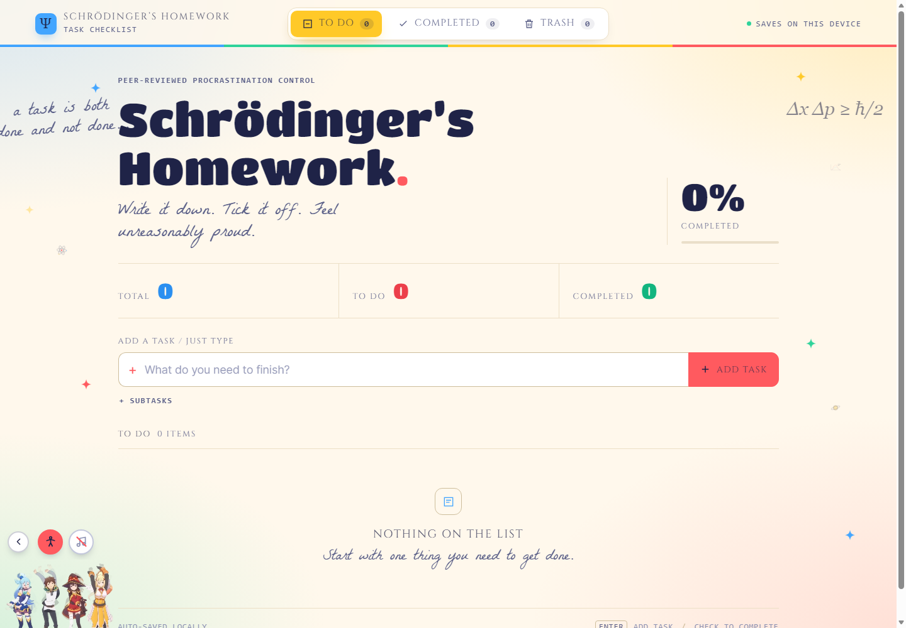

# Online Checklist

A tiny task tracker for people who have approximately 47 things to do and remember 3 of them.

🌐 **Live site:** https://online-checklist.netlify.app/
☕ **Enjoying it?** [Buy me a coffee](https://buymeacoffee.com/Ayu_rax) — help fuel the next questionable improvement.

## Screenshot

## What it does

- Create tasks and break them into subtasks.
- Track completion with progress indicators.
- Move between To Do, Completed, and Trash.
- Restore deleted tasks or remove them permanently.
- Save tasks automatically in your browser.
- Use it without creating an account.

## Run it locally

1. Clone this repository.
2. Open index.html in your browser.

That's it. No package installation, build step, or 14-layer JavaScript framework required.

## Data and privacy

Tasks are saved in your browser's local storage on that device. There is no cloud account or automatic sync between devices. Clearing browser storage may erase your saved tasks.

## Built with

- HTML
- CSS
- Vanilla JavaScript

## Feedback

Found a bug or have a sensible improvement? Open a GitHub issue.

---
